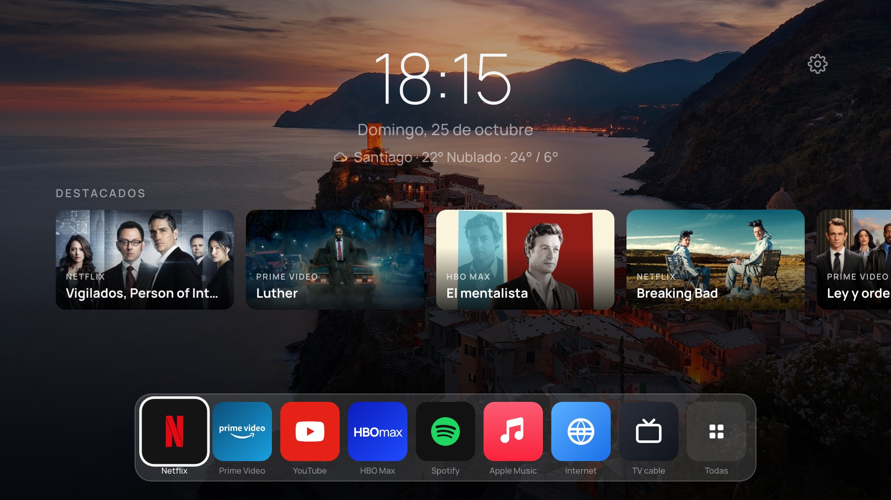
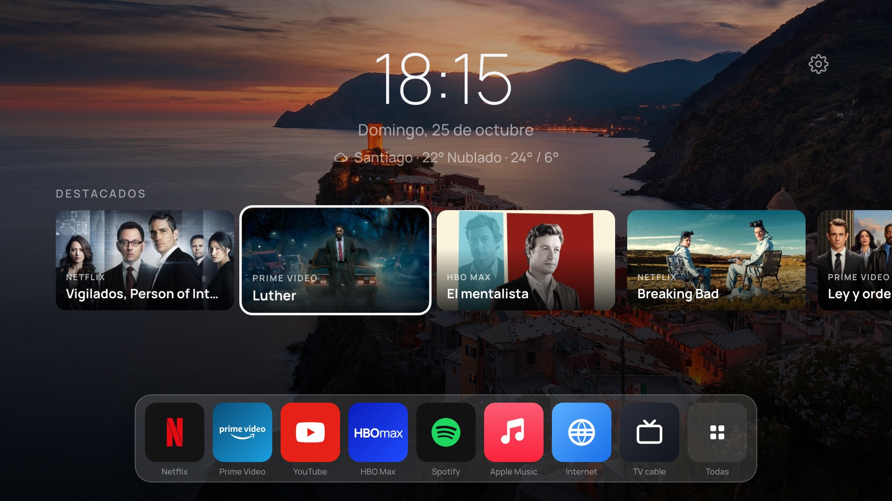
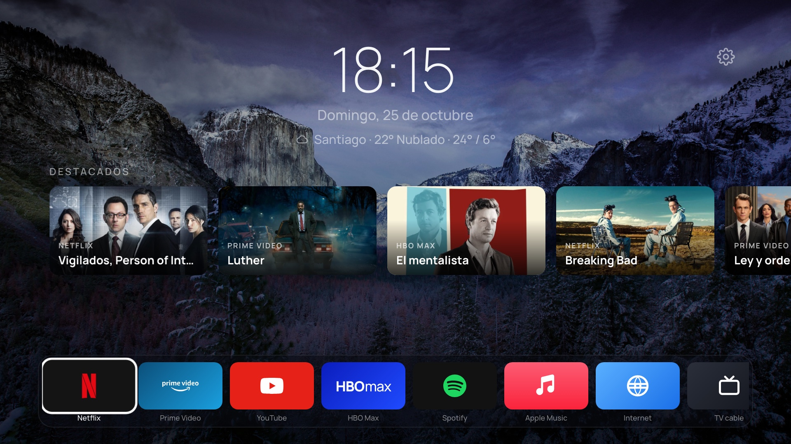
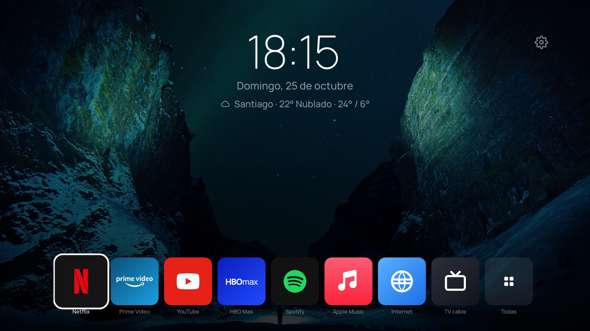
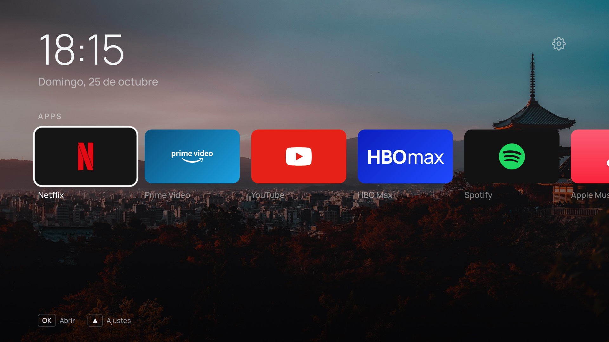
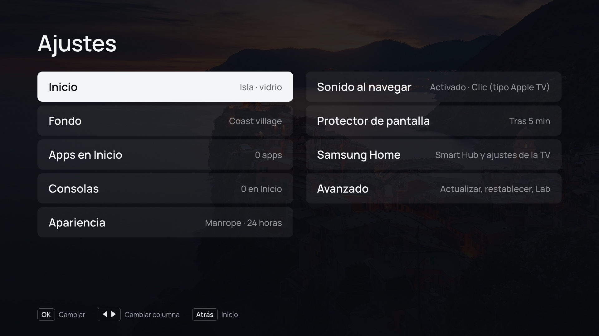
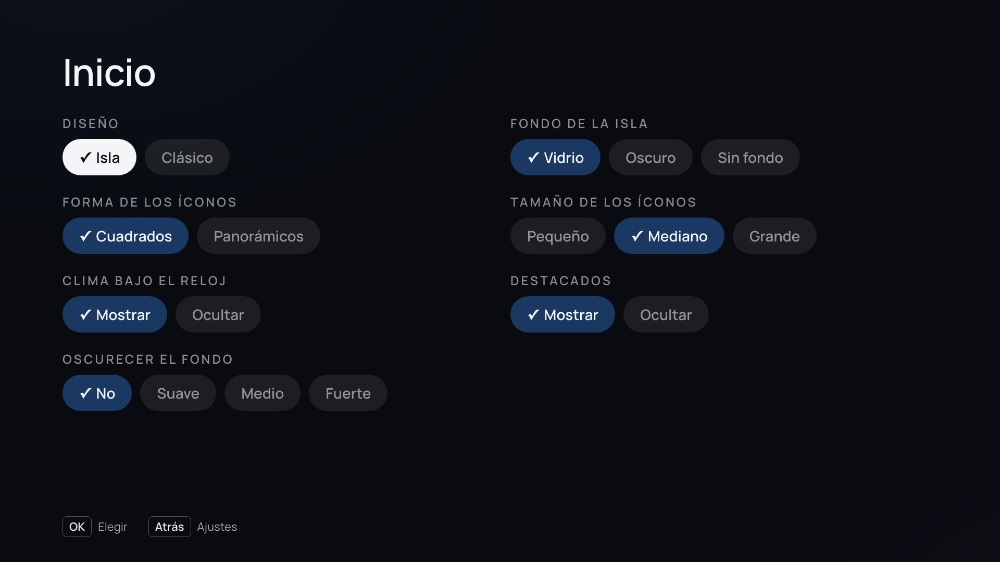
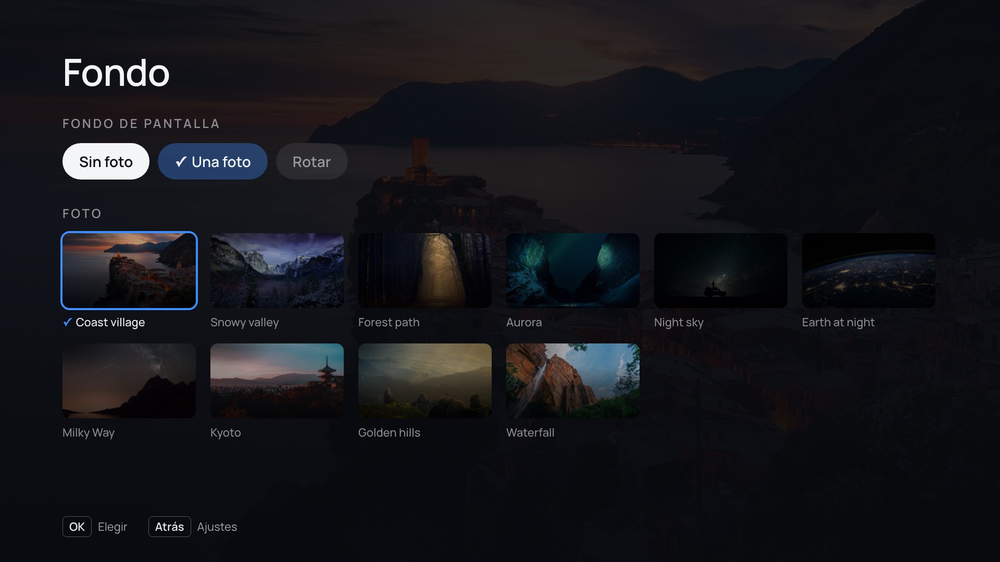
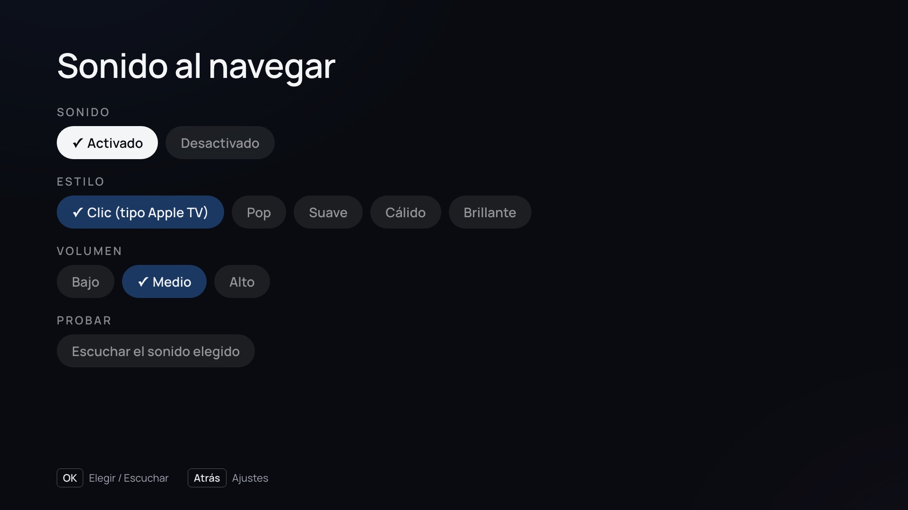
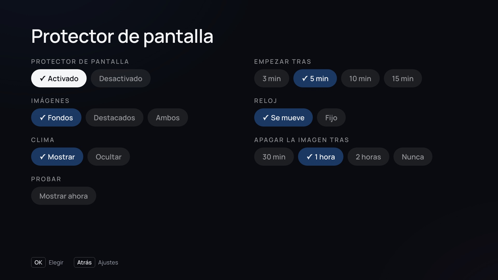

# Samsung TizenMod 5.x

Un inicio más limpio para televisores Samsung con **Tizen 5.x** (probado en una UN55TU7090, 2020,
Tizen 5.5): reloj y clima, una fila de títulos destacados de tus servicios de streaming y tus
apps en una isla abajo. Sin publicidad de Samsung, controlado con el control remoto normal.



Además: YouTube sin anuncios con [TizenTube](https://github.com/reisxd/TizenTube), un acceso
directo a la TV por cable, sonidos al navegar y una guía de privacidad para la TV.

## Qué hay aquí

| Carpeta | Contenido |
| --- | --- |
| [`launcher/`](launcher/) | TizenMod, el launcher (app web `.wgt`). Fork de [arn0-tv](https://github.com/NelsonEU/arn0-tv). |
| [`docs/BITACORA.md`](docs/BITACORA.md) | Todo el proceso, paso a paso y con los comandos, desde activar el modo desarrollador. |
| [`docs/TIZENMOD.md`](docs/TIZENMOD.md) | Qué cambia respecto del original y cómo configurarlo. |
| [`docs/PRIVACIDAD.md`](docs/PRIVACIDAD.md) | Ajustes a mano: arrancar en TizenMod, barra de Samsung, privacidad, DNS. |
| [`scripts/`](scripts/) | Instalar en la TV, conectar `sdb` desde macOS, generar capturas. |
| [`capturas/`](capturas/) | Todas las pantallas de TizenMod. |

## Lo que se puede y lo que no

El modo desarrollador de Samsung permite instalar, abrir, cerrar y desinstalar apps propias
firmadas, y nada más: no hay consola, no hay root y los ajustes del sistema solo cambian desde los
menús. Por eso TizenMod es una app que se abre desde la barra de Samsung (y que la TV puede reabrir
al encender), no un reemplazo del sistema. El botón Home del control sigue siendo de Samsung.
Detalle en la [bitácora, paso 11](docs/BITACORA.md#paso-11--qué-permite-exactamente-el-modo-desarrollador).

## Instalación rápida

Requisitos: un Mac (o PC) en la misma red, [Tizen Studio CLI](https://developer.samsung.com/smarttv/develop/getting-started/setting-up-sdk/installing-tv-sdk.html),
Node.js 20+ y una cuenta Samsung para el certificado.

1. **Modo desarrollador** en la TV: Apps → `1 2 3 4 5` → On, IP de tu computador, reiniciar.
2. **Certificado Samsung** (Certificate Manager → Samsung → TV), distribuidor nivel **Partner**
   con el DUID de tu TV (`sdb shell 0 getduid`).
3. **Configuración**: copia `launcher/src/js/config.local.example.js` a `config.local.js` y pon tus
   apps, ciudad y, si quieres Destacados, un token de TMDB.
4. **Fondos de tu país o ciudad** (opcional, no entran al repo):
   `node launcher/scripts/add-wallpapers.mjs <carpeta> [creditos.json]`.
5. **Compilar e instalar**:

   ```sh
   cd launcher && npm run build
   ../scripts/instalar.sh dist/tizenmod.wgt --abrir
   ```

En macOS, `sdb` no llega a la TV por el permiso de Red local; `scripts/instalar.sh` usa
`scripts/sdb-proxy.py` para resolverlo (ver bitácora, paso 3).

## Capturas

| | |
| --- | --- |
|  Destacados |  Íconos panorámicos, isla oscura |
|  Íconos grandes, sin fondo de isla |  Diseño clásico |
|  Ajustes |  Ajustes → Inicio |
|  Fondos |  Sonido al navegar |
|  Protector de pantalla |  Protector con destacados |

Las capturas salen de la vista previa del launcher (el mismo código que corre en la TV, con la
lista de apps real de la TV), porque Tizen no permite capturar la pantalla del televisor.
`scripts/capturas.mjs` las regenera.

## Créditos

- [arn0-tv](https://github.com/NelsonEU/arn0-tv) de Arnaud Etienne (MIT), la base del launcher.
- [TizenTube](https://github.com/reisxd/TizenTube) de reisxd.
- Datos e imágenes de Destacados: [TMDB](https://www.themoviedb.org/). Este producto usa la API de
  TMDB pero no está respaldado ni certificado por TMDB.
- Clima: [Open-Meteo](https://open-meteo.com/).
- Marcas de apps: [Simple Icons](https://simpleicons.org/) (CC0) y Custom Brand Icons (MIT); las
  marcas pertenecen a sus dueños.

Licencia MIT ([`LICENSE`](LICENSE)). Proyecto independiente, sin relación con Samsung.
